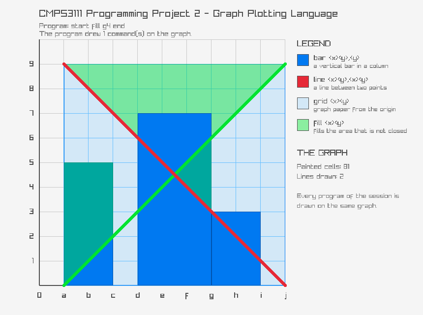
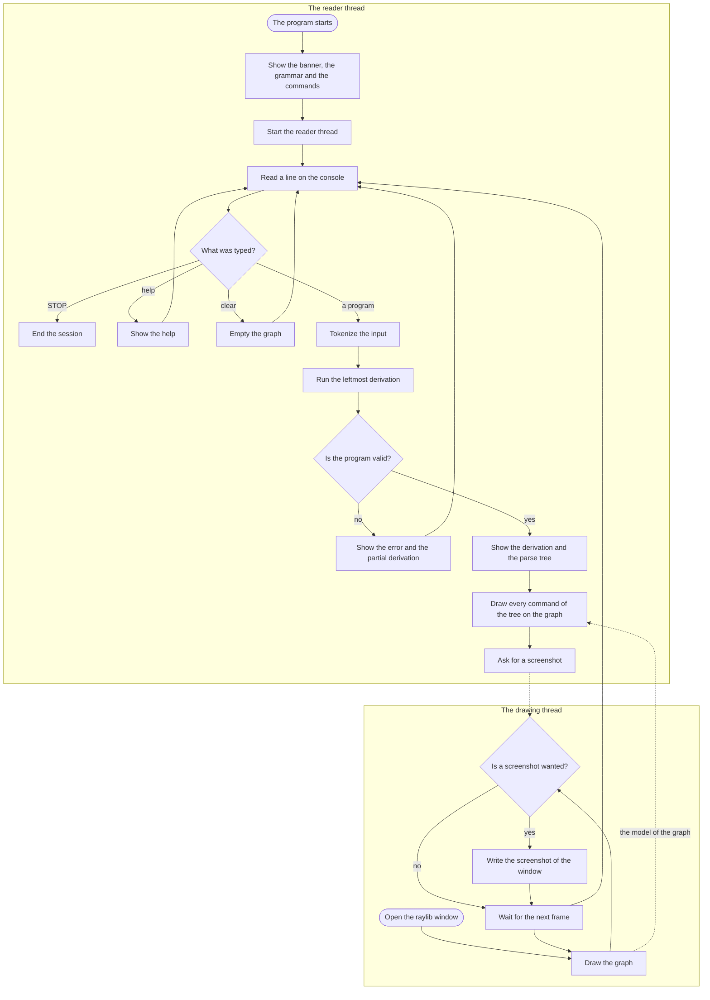

# CMPS3111 Programming Project 2 — Graph Plotting Language

A graph plotting language written in D.  Every program that is typed is
checked by a **real leftmost derivation** over the grammar of the language, and
the program shows

* whether the input is a sentence of the grammar,
* every step of the leftmost derivation,
* the parse tree,
* and the resulting graph, drawn in a raylib window.

All the programs of a session are drawn on **one shared graph**, so the
commands of several programs can be seen together.



---

## The language

### The grammar

```
<graph>      -> start <plot_stmts> end
<plot_stmts> -> <plot> | <plot> ; <plot_stmts>
<plot>       -> bar <x><y>,<y>
              | line <x><y>,<x><y>
              | grid <x><y>
              | fill <x><y>
<x>          -> a | b | c | d | e | f | g | h | i | j
<y>          -> 0 | 1 | 2 | 3 | 4 | 5 | 6 | 7 | 8 | 9
```

A program is written on **one line** and has to start with `start` and end
with `end`:

```
start bar a1,5;line a1,b1 end
```

### The graph

The graph is a grid of ten columns and ten rows.  The columns are named `a`
to `j` from left to right, the rows are numbered `0` to `9` with the row `0`
at the bottom.

The labels are drawn on the gridlines: the letter of a column is under the
gridline at its right edge and the digit of a row is beside the gridline below
it.  The origin is therefore `a0` and the point `a1` is the lower right corner
of the cell `a1`.

### The commands

| Command            | What it does                                                                                  |
| ------------------ | --------------------------------------------------------------------------------------------- |
| `bar <x><y>,<y>`   | A vertical bar in the column `<x>` that spans the rows `<y>` to `<y>`.  `bar a1,5` draws the bar in the column `a` from the row 1 to the row 5. |
| `line <x><y>,<x><y>` | A straight line between two points of the graph, the points being the crossings of the gridlines.  `line a1,b1` draws the line from the point `a1` to the point `b1`. |
| `grid <x><y>`      | Graph paper that covers the area between the origin `a0` and the cell `<x><y>`.  `grid c5` covers the columns `a`, `b` and `c` and the rows 0 to 5. |
| `fill <x><y>`      | Fills the area that is not closed by the bars, the lines and the graph paper, starting at the cell `<x><y>`. |

The rows of a bar may be given in any order, `bar a5,1` is the same as
`bar a1,5`.

### The rules of a fill

A fill spreads over the cells that are reachable from the cell it starts in,
and it stops at everything that is solid:

* a **bar** is solid,
* a **line** is solid,
* the **lattice of a grid** is solid.

A fill that starts **inside** the lattice of a grid stays in the cell it
starts in, because the grid paper closes the cell around it.  A fill that
starts on a bar or on a line does nothing at all.

---

## Running the program

The program is built with [dub](https://dub.pm/).  The library of raylib is in
the folder of the project, so no extra download is needed.

### Build

```bash
dub build --arch=x86_64
```

The build writes the program in `plp2.exe`.  The folder of the project already
holds a built `plp2.exe` and the `raylib.dll` that it needs, so the program can
also be started without building it first.

### Run

```bash
dub run --arch=x86_64
```

or simply

```bash
./plp2.exe
```

The program opens a window with the graph and reads the programs on the
console.

| Word on the console | What it does                                          |
| ------------------- | ----------------------------------------------------- |
| a program           | Checks the program, shows the derivation and the tree and draws it. |
| `help`              | Shows the commands of the language again.             |
| `clear`             | Empties the graph.                                    |
| `STOP`              | Leaves the program.                                   |

### The options of the command line

| Option       | What it does                                                     |
| ------------ | ---------------------------------------------------------------- |
| `--no-gui`   | Runs the program without a window, which is useful when the output of the console is what matters. |
| `--quiet`    | Suppresses the leftmost derivation and the parse tree.           |
| `--help`     | Shows the help of the program.                                   |

### The tests

```bash
dub test --arch=x86_64
```

The tests are built in `plp2-test-application.exe` and they are run by the
command above.  The tests cover the analyzer, the model of the graph, the
commands and the texts of the console.

---

## How the program is built

| Module            | What it holds                                                        |
| ----------------- | -------------------------------------------------------------------- |
| `source/grammar.d` | The grammar of the language as data.                                |
| `source/analyzer.d` | The engine of the leftmost derivation.  It recognises the programs, records every sentential form and builds the parse tree. |
| `source/parsetree.d` | The nodes of the parse tree and the drawing of the tree as an ASCII tree. |
| `source/commands.d` | Turns the `<plot>` nodes of the tree into the commands of the graph. |
| `source/scene.d`  | The model of the graph.  It has no dependency on the graphics library, so it can be tested without a window. |
| `source/renderer.d` | Draws the model of the graph in a raylib window.                    |
| `source/layout.d` | Pure layout math for the graph window (DPI-aware, resizable). |
| `source/win32.d` | Windows helpers for DPI awareness and console focus. |

The analyzer and the model of the graph are two separate modules, so the
logic of the language can be tested without opening a window.

### The analyzer

The analyzer keeps the current **sentential form** as an explicit list of
symbols.  At every step it expands the leftmost nonterminal of that form with
one of its productions, which is exactly the definition of a leftmost
derivation.  The terminals are matched against the input as they are produced,
so the derivation doubles as a recogniser.  One pass gives the validity of the
program, the derivation, the parse tree and, for an invalid program, the
partial derivation that led to the error.

### The model of the graph

The graph is a grid of ten by ten cells.  A cell holds the kinds of plot that
were drawn on it as flags, so a line that runs over a bar keeps both of them.
The model knows nothing about raylib, which keeps it easy to test.

---

## The flow of the program

The program has two threads.  The **reader** reads the console and changes the
model of the graph, the **drawing** thread shows the model in the window.  They
share the model through a lock, so the window keeps redrawing while the user
is typing.



---

## The extensions that were used

| Extension                                      | What it is used for                        |
| ---------------------------------------------- | ----------------------------------------- |
| [D-Code for Visual Studio Code](https://marketplace.visualstudio.com/items?itemName=tonyjewel.d-code) | The syntax highlighting of the D language. |
| [raylib-d](https://code.dlang.org/packages/raylib-d) | The window and the drawing of the graph.  |
| [dub](https://dub.pm/)                          | The build system and the test runner.     |
